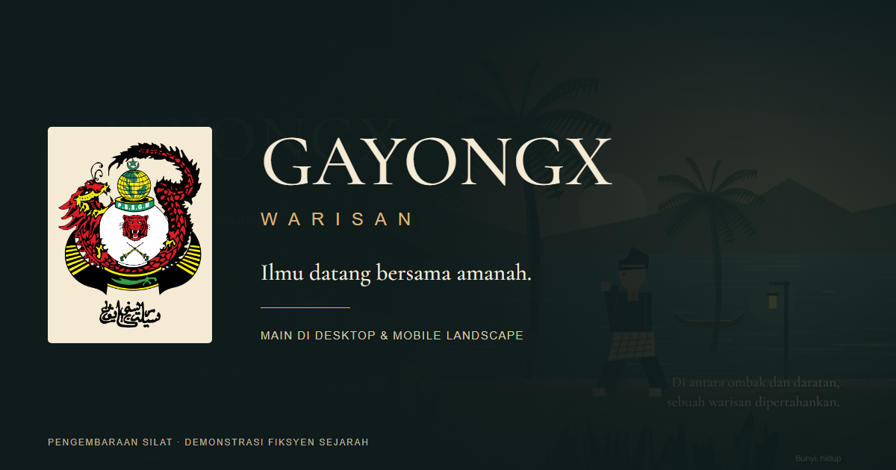

  

  <h1>GAYONGX: WARISAN</h1>
  
<strong>A 2D Silat Action-Adventure Game Built with Phaser 3 & TypeScript</strong>

  

    
    
    
    
  

  

    
    
    
    
    
    
  

---

## Overview

- **Functionality**: 2D action-adventure web game built in Phaser 3 and TypeScript dramatizing historical silat heritage, complete with custom frame-based hitbox mechanics, parry systems, and interactive storyline quests.
- **Aesthetic Value**: Evocative retro pixel and canvas rendering paired with handcrafted heritage sprites, authentic combat soundscapes, and responsive mobile touch controls.
- **Business Value**: Preserves cultural martial heritage through gamified educational interaction, engaging digital-native audiences with traditional silat techniques and historical lore.

A self-contained Phaser 3, TypeScript, Vite, and HTML5 Canvas demo. A fictional villager, Arif, explores a coastal kampung, trains with a dramatized portrayal of Meor Abdul Rahman, and protects the jetty from intruders.

> **Historical Dramatization**: Dialogue, characters, and events are presented as interactive fiction rather than documentary evidence.

---

## Gameplay & Controls

- **Desktop Controls**: A/D (Move), Shift (Sprint), Space (Jump), J (Attack), K (Heavy Attack), L (Block / Parry), Q (Dodge), F / E (Interact), Enter (Confirm), Escape (Pause).
- **Mobile Touch Controls**: Landscape on-screen virtual joypad and combat action triggers with haptic-adapted feedback.
- **Accessibility & Settings**: The pause menu includes audio balance toggles and reduced-motion preferences.

---

## Chapter 1 Narrative Flow

1. **1942 Prologue**: Opening cinematic reveal of Pulau Sudong heritage backdrop.
2. **Kampung Exploration**: Interactive villager dialogues, local lore discovery, and cultural context.
3. **Six Combat Lessons**: Progressive mechanics tutorials covering combo chaining, heavy strikes, blocking, parrying, dodging, and takedowns.
4. **Jetty Defense**: Dynamic boss encounter against guarded intruders testing all learned martial techniques.
5. **Epilogue**: Concluding mentor dialogue and chapter resolution.

---

## Technical Architecture

- **Phaser Scenes**: Modular state management across boot, menu, narrative cutscenes, gameplay arena, and victory screens.
- **Combat Mechanics**: Discrete windup, active, and recovery phases with input buffering and deterministic frame-based hitboxes.
- **Responsive Canvas Rendering**: Phaser FIT scaling ensures consistent 1280 × 720 game presentation across all mobile and desktop viewports without WebGL hardware requirements.
- **Decoupled Rules Engine**: Independent damage calculation, guard metering, reach collision, and combo timers.

---

## Continuous Integration & Quality

Game stability is validated automatically through continuous testing workflows:
- **Unit Verification**: Vitest test suite executing deterministic combat calculations, guard breaks, and state transition logic.
- **Type Checking**: Strict TypeScript compiler checks ensuring zero runtime type regressions.
- **Automated CI**: GitHub Actions workflow (`.github/workflows/ci.yml`) runs on every push and pull request to `main`.

---

## License

Copyright (c) 2026 Muhammad Syahmi ([syahmiaof](https://syahmiaof.my)). All rights reserved.  
Proprietary source code created solely for demonstration and portfolio showcase purposes.
